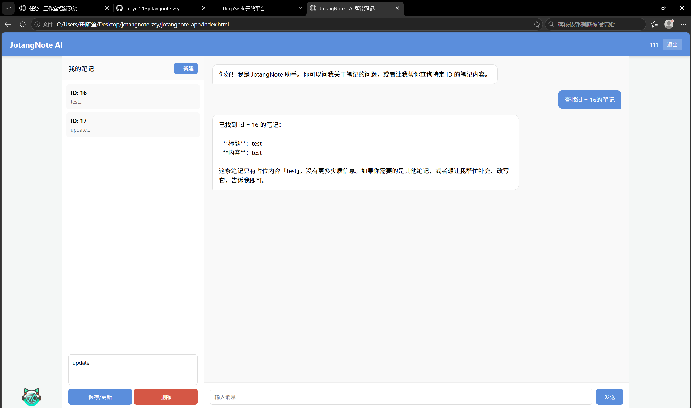

# 项目说明文档 进阶篇
````python
from flask_cors import CORS
````
**解决跨域**：由于我的前后端所用的端口不同，需加上这条命令才能实现跨域。

---
````python
from openai import OpenAI
````
由于 DeepSeek 的接口和 OpenAI 完全兼容，所以这里**借用 OpenAI 的 SDK 来连 DeepSeek**。

----
````python
api_key = os.environ.get("DEEPSEEK_API_KEY")
if not api_key:
    sys.exit("错误：未检测到环境变量 DEEPSEEK_API_KEY，请先设置后再运行。")
````
从**环境变量**中读取密钥，避免密钥泄露到代码仓库中。

----
- **会话管理**
````python
chat_sessions = {}
MAX_HISTORY_SIZE = 20

def get_history(session_id):
    if session_id not in chat_sessions:
        chat_sessions[session_id] = [
            {"role": "system", "content": "你是一个乐于助人的AI助手。"}
        ]
    return chat_sessions[session_id]
````
- `chat_sessions` 是一个字典，用 `session_id` 当钥匙，每个用户/每个窗口存一份自己的对话历史。
- `get_history()`：第一次来某个会话时，给它初始化一份，里面先放一条 `system` 消息（角色设定），用来给 AI"定人设"；已存在就直接返回。
- `MAX_HISTORY_SIZE = 20`：历史最多留 20 条，防止无限增长吃内存。

----
- **向ai声明工具**
````python
tools = [ { "type": "function", "function": {
    "name": "query_note",
    "description": "根据笔记 ID 查询笔记的全文内容",
    "parameters": { "type": "object", "properties": {
        "note_id": { "type": "string", "description": "笔记的唯一标识 ID" }
    }, "required": ["note_id"] } } } ]
````
----
````python
def execute_query_note(note_id):
    conn = None
    try:
        conn = pymysql.connect(host=..., database=DB_NAME, charset='utf8mb4')
        cursor = conn.cursor(pymysql.cursors.DictCursor)
        sql = "SELECT * FROM notes WHERE id = %s"
        cursor.execute(sql, (note_id,))
        result = cursor.fetchone()
        if result:
            return f"【标题】：{...} \n【内容】：{...}"
        else:
            return f"未找到 ID 为 {note_id} 的笔记内容"
    except Exception as e:
        return f"查询数据库时出错：{str(e)}"
    finally:
        if conn: conn.close()
````
1. `conn = None`：先占个位，保证后面 `finally` 里判断连接是否存在不会报错。
2. `pymysql.connect(...)`：用模块二那 5 个配置连上数据库，`charset='utf8mb4'` 保证中文不乱码。
3. `cursor(...DictCursor)`：拿一个"游标"，`DictCursor` 表示查出来的一行是一个字典（列名→值），方便用 `result.get('title')` 取值。
4. `sql = "SELECT * FROM notes WHERE id = %s"`：要执行的查询。`%s` 是占位符（防 SQL 注入的安全写法），不要手动拼字符串。这里表名是 `notes`。
5. `cursor.execute(sql, (note_id,))`：把 `note_id` 填进 `%s` 并执行。
6. `cursor.fetchone()`：取出查询到的那一行（一条记录）。
7. 查到了就拼成"标题+内容"的可读文本返回；没查到返回"未找到"。
8. `except` 捕获任何异常（连不上、表不存在等），把错误原样返回——这样错误信息会顺着链路传回前端，方便你排查。
9. `finally` 里 `conn.close()`：无论成功失败都必须关闭连接，避免连接泄漏。
----
````python
@app.route('/chat', methods=['POST'])
def chat_with_ai():
    data = request.get_json()
    user_message = data.get('message')
    session_id = data.get('session_id', 'default_session')
    if not user_message:
        return jsonify({"error": "消息不能为空"}), 400
    current_history = get_history(session_id)
````
- `@app.route('/chat', methods=['POST'])`：注册一个网址 `/chat`，前端用 `POST` 方式往这里发"用户说的话"。
- 取出用户消息 `message` 和会话号 `session_id`（没传就用默认）。
- 如果消息为空，直接返回 `400` 错误。
- `get_history(session_id)`：取到这个会话到目前为止的全部历史。
----
````python
current_history.append({"role": "user", "content": user_message})
````
把用户这句新话追加进历史里。

-----
- **工具调用主循环**
````python
while True:
    response = client.chat.completions.create(
        model="deepseek-chat",
        messages=current_history,
        tools=tools,
        tool_choice="auto",
        stream=False
    )
    response_message = response.choices[0].message
````
- `create(...)`：把当前全部历史 + 工具清单发给 DeepSeek。`tool_choice="auto"` 表示"AI 你自己决定要不要用工具"；`stream=False` 表示一次性返回完整结果（不流式）。
- `response.choices[0].message`：取出 AI 这次的回复对象。
----
````python
    current_history.append({
        "role": response_message.role,
        "content": response_message.content,
        "tool_calls": response_message.tool_calls
    })
````
把 AI 这条回复（可能包含"我要调工具"的指令）也存回历史

----
````python
    if response_message.tool_calls:
        for tool_call in response_message.tool_calls:
            function_name = tool_call.function.name
            function_args = json.loads(tool_call.function.arguments)
            if function_name == "query_note":
                function_response = execute_query_note(function_args.get("note_id"))
            else:
                function_response = "未找到该函数"
            current_history.append({
                "role": "tool",
                "tool_call_id": tool_call.id,
                "content": function_response
            })
        continue
````
- `if response_message.tool_calls:`：判断 AI 这次是否决定调用工具。
- `for tool_call in ...`：AI 可能一次要调多个工具，逐个处理。
- `function_name`：取出 AI 想调用的函数名（如 `query_note`）。
- `json.loads(tool_call.function.arguments)`：AI 给的参数是一段 JSON 文本，解析成字典。
- `if function_name == "query_note`"：名字对上了，就真的执行 `execute_query_note`（即真去查数据库），结果存进 `function_response`。名字不对则返回"未找到该函数"（兜底）。
`current_history.append({"role": "tool", ...})`：把查询结果作为一条 `tool` 角色消息追加进历史。`tool_call_id` 是把这条结果和 AI 那次调用对应起来的编号，必须回传。
continue：回到 `while` 循环顶部，带着"用户提问 + AI要调工具 + 工具查到的结果"再请求一次 AI。这时 AI 拿到了真实数据，就能生成最终自然语言回答了。
----
````python
    else:
        ai_reply = response_message.content
        break
````
如果 AI 这次不再调用工具，说明它已经准备好最终答案，取出 `content` 存为 `ai_reply`，`break` 跳出循环。

---
- **历史滑动窗口+返回结果**
````python
if len(current_history) > MAX_HISTORY_SIZE:
    chat_sessions[session_id] = [current_history[0]] + current_history[-(MAX_HISTORY_SIZE - 1):]

return jsonify({"reply": ai_reply, "session_id": session_id})
````
- 如果历史超过 20 条，就做一次"修剪"：永远保留第 0 条（那是 `system` 角色设定，不能丢），再保留最近 19 条，中间的旧对话丢掉。这样既保住人设，又控制长度。
- `return jsonify(...)`：把 AI 的最终回答和会话号以 JSON 返回给前端网页。
----
````python
except Exception as e:
    current_history.pop()
    return jsonify({"error": str(e)}), 500
````
- 一旦整个流程出错，`current_history.pop()` 把刚才追加的那条用户消息删掉——否则失败的消息会留在历史里污染下次对话。
- 返回 `500` 错误和具体异常文本。

