# 项目说明文档 入门篇
## 流程图
- **注册**
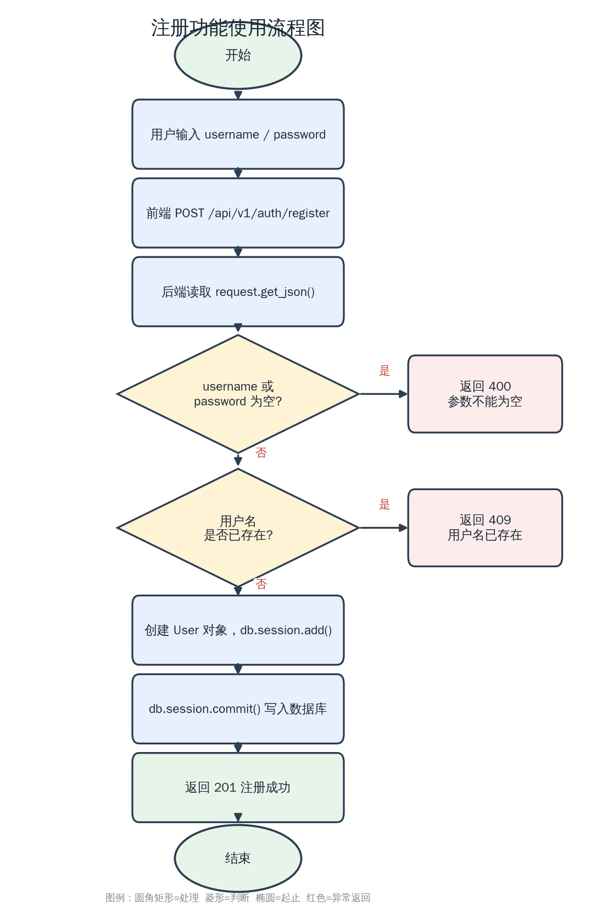

- **登录**
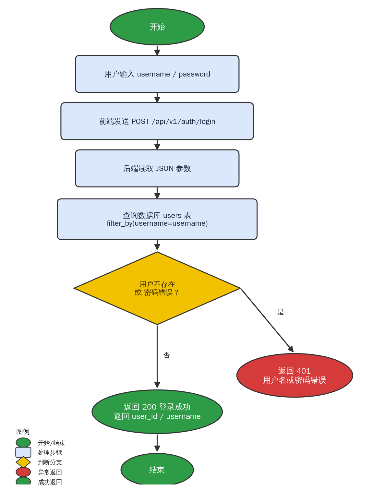

- **创建**
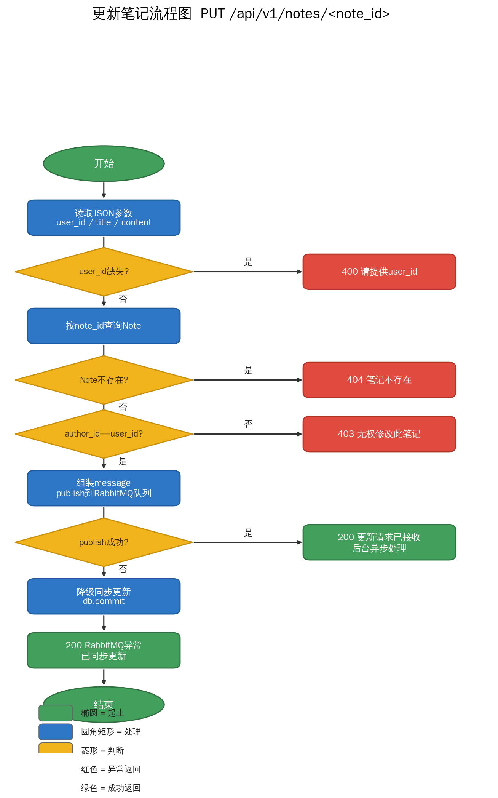

- **查询**
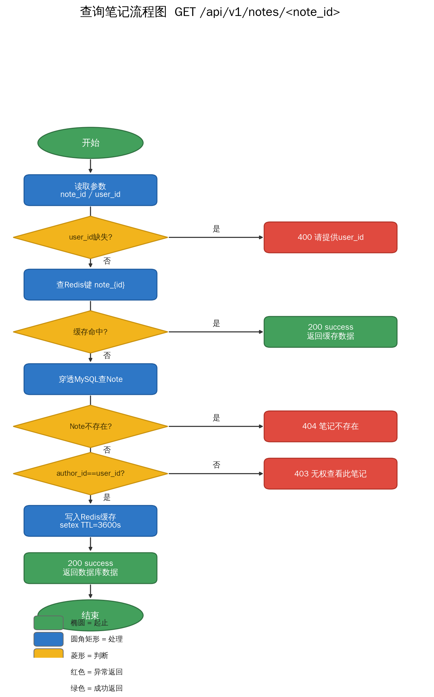

- **更新**
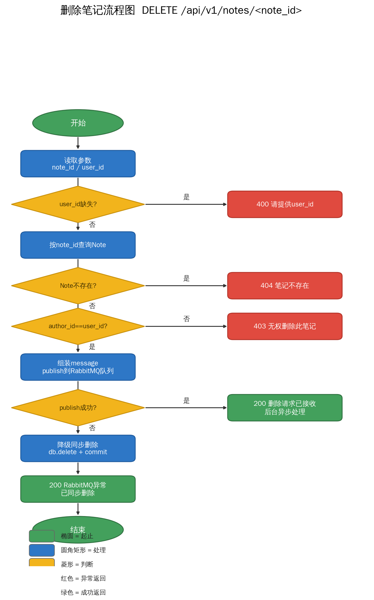

- **删除**
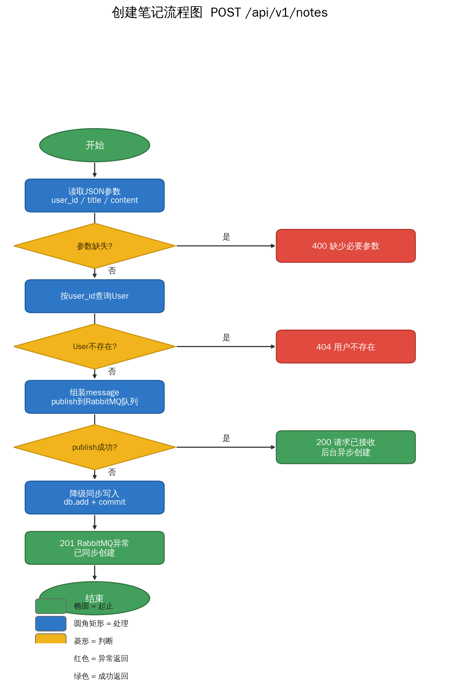

## 代码说明
- **注册**
````python
@app.route("/api/v1/auth/register", methods=["POST"])
def register():
    data = request.get_json()
    username = data.get("username")
    password = data.get("password")

    if not username or not password:
        return jsonify({"code": 400, "msg": "用户名和密码不能为空"}), 400

    existing_user = User.query.filter_by(username=username).first()
    if existing_user:
        return jsonify({"code": 409, "msg": "用户名已存在"}), 409

    new_user = User(username=username, password=password)
    db.session.add(new_user)
    db.session.commit()

    return jsonify({"code": 201, "msg": "注册成功，快去登录吧！"}), 201
````
1. `request.get_json()` 取出请求体 `JSON`。
2. 读取 `username`、`password`。
3. 空值校验：任一为空 → 返回 `400「用户名和密码不能为空」`。
4. 查重：`User.query.filter_by(username=username).first()` 查库，已存在 → 返回 `409「用户名已存在」`。
5. 创建 `User` 对象，`db.session.add` 加入会话，`db.session.commit` 提交写入数据库。
6. 成功返回 `201「注册成功」`。  
---
- **登录**
````python
@app.route("/api/v1/auth/login", methods=["POST"])
def login():
    data = request.get_json()
    username = data.get("username")
    password = data.get("password")

    user = User.query.filter_by(username=username).first()

    if not user or user.password != password:
        return jsonify({"code": 401, "msg": "用户名或密码错误"}), 401

    return jsonify(
        {
            "code": 200,
            "msg": "登录成功",
            "data": {"user_id": user.id, "username": user.username},
        }
    )
````
1. 取出 `username、password`。
2. 按用户名查用户。
3. 核心判断：`if not user or user.password != password` —— 用户不存在，或密码不匹配，统一返回 401「用户名或密码错误」（故意用同一句提示，避免暴露账号是否存在）。
4. 校验通过返回 `200`，并返回 `user_id` 和 `username` 供后续接口使用。
---
- **创建**
````python
@app.route("/api/v1/notes", methods=["POST"])
def create_note():
    data = request.get_json()
    user_id = data.get("user_id")

    if not user_id or not data.get("title") or not data.get("content"):
        return jsonify({"code": 400, "msg": "缺少必要参数"}), 400

    user = db.session.get(User, user_id)
    if not user:
        return jsonify({"code": 404, "msg": "用户不存在"}), 404

    message = {
        "action": "create",
        "data": {
            "title": data["title"],
            "content": data["content"],
            "author_id": user_id,
        },
    }

    if publish_note_message(message):
        return jsonify({"code": 200, "msg": "请求已接收，正在后台异步创建笔记..."})

    # 降级：RabbitMQ 不可用时同步写入
    note = Note(
        title=data["title"],
        content=data["content"],
        author_id=user_id,
    )
    db.session.add(note)
    db.session.commit()
    return jsonify({"code": 201, "msg": "RabbitMQ异常，已同步创建", "data": {"id": note.id}}), 201
````
1. 取出 `user_id`，并校验 `user_id`、`title`、`content` 三者，缺任一 → `400「缺少必要参数」`。
2. `db.session.get(User, user_id)` 按主键查用户，不存在 → `404「用户不存在」`。
3. 组装消息体 `{"action":"create", "data":{title,content,author_id}}`。
4. 异步优先：调用 `publish_note_message` 投递到队列，成功就立即返回 `200「正在后台异步创建」`——主接口不阻塞写库，真正的写库交给消费者线程。
5. 降级兜底：若队列投递失败（RabbitMQ 挂了），退化为同步：直接 `Note`(...) 建对象、`add`、`commit`，返回 `201「已同步创建」`并带回新笔记 id。
---
- **查询**
````python
@app.route("/api/v1/notes/<int:note_id>", methods=["GET"])
def get_note(note_id):
    user_id = request.args.get("user_id")
    if not user_id:
        return jsonify({"code": 400, "msg": "请提供 user_id"}), 400

    redis_key = f"note_{note_id}"
    cached_data = redis_client.get(redis_key)

    if cached_data:
        return jsonify(
            {
                "code": 200,
                "msg": "success (缓存命中)",
                "data": json.loads(cached_data),
            }
        )

    note = db.session.get(Note, note_id)
    if not note:
        return jsonify({"code": 404, "msg": "笔记不存在"}), 404

    if note.author_id != int(user_id):
        return jsonify({"code": 403, "msg": "无权查看此笔记"}), 403

    note_data = {
        "id": note.id,
        "title": note.title,
        "content": note.content,
    }

    redis_client.setex(redis_key, 3600, json.dumps(note_data))

    return jsonify({"code": 200, "msg": "success (数据库查询)", "data": note_data})
````
1. 从 URL 查询参数 `request.args.get("user_id")` 取用户 id，缺失 → `400`。
2. 先查缓存：拼出缓存 `key note_{note_id}`，`redis_client.get` 取值。
3. 缓存命中：直接 `json.loads` 反序列化返回 `200「缓存命中」`，完全不碰数据库。
4. 缓存未命中：`db.session.get(Note, note_id) `查库；不存在 → `404`。
5. 权限校验：`note.author_id != int(user_id)` → `403「无权查看」`。
6. 组装 `note_data`，用 `setex(key, 3600, json)` 写入 Redis 并设 3600 秒（1 小时）过期时间。
7. 返回 `200「数据库查询」`。
---
- **更新**
````python
@app.route("/api/v1/notes/<int:note_id>", methods=["PUT"])
def update_note(note_id):
    data = request.get_json()
    user_id = data.get("user_id")

    if not user_id:
        return jsonify({"code": 400, "msg": "请提供 user_id"}), 400

    note = db.session.get(Note, note_id)
    if not note:
        return jsonify({"code": 404, "msg": "笔记不存在"}), 404

    if note.author_id != int(user_id):
        return jsonify({"code": 403, "msg": "无权修改此笔记"}), 403

    message = {
        "action": "update",
        "data": {
            "id": note_id,
            "title": data.get("title"),
            "content": data.get("content"),
            "author_id": int(user_id),
        },
    }

    if publish_note_message(message):
        return jsonify({"code": 200, "msg": "更新请求已接收，正在后台异步处理..."})

    # 降级同步更新
    if "title" in data:
        note.title = data["title"]
    if "content" in data:
        note.content = data["content"]
    db.session.commit()
    return jsonify({"code": 200, "msg": "RabbitMQ异常，已同步更新"})
````
1. 从 body 取 `user_id`，缺失 → `400`。
2. 查笔记，不存在 → `404`。
3. 权限校验，非作者 → `403「无权修改」`。
4. 组 `action:"update"` 消息（带上要改的 title/content）。
5. 异步成功 → `200「后台异步处理」`。
6. 降级同步：只有 body 里出现 `title`/`content` 字段才更新对应字段（部分更新语义），`commit` 后返回 `200`。
---
- **删除**
````python
@app.route("/api/v1/notes/<int:note_id>", methods=["DELETE"])
def delete_note(note_id):
    user_id = request.args.get("user_id")
    if not user_id:
        return jsonify({"code": 400, "msg": "请提供 user_id"}), 400

    note = db.session.get(Note, note_id)
    if not note:
        return jsonify({"code": 404, "msg": "笔记不存在"}), 404

    if note.author_id != int(user_id):
        return jsonify({"code": 403, "msg": "无权删除此笔记"}), 403

    message = {
        "action": "delete",
        "data": {
            "id": note_id,
            "author_id": int(user_id),
        },
    }

    if publish_note_message(message):
        return jsonify({"code": 200, "msg": "删除请求已接收，正在后台异步处理..."})

    # 降级同步删除
    db.session.delete(note)
    db.session.commit()
    return jsonify({"code": 200, "msg": "RabbitMQ异常，已同步删除"})
````
1. 从查询参数取 `user_id`，缺失 → `400`。
2. 查笔记，不存在 → `404`。
3. 权限校验，非作者 → `403「无权删除」`。
4. 组 `action:"delete"` 消息（含 id、author_id）。
5. 异步成功 → `200「后台异步处理」`。
6. 降级同步：`db.session.delete(note)` + `commit`，返回 `200`。
----
- **消息消费者回调**
````python
def callback(ch, method, properties, body):
    message = json.loads(body)
    action = message.get("action")
    data = message.get("data")

    print(f"[消费者] 收到消息: {message}")

    with app.app_context():
        try:
            if action == "create":
                new_note = Note(
                    title=data["title"],
                    content=data["content"],
                    author_id=data["author_id"],
                )
                db.session.add(new_note)
                db.session.commit()
                print(f"[消费者] 笔记创建成功, ID: {new_note.id}")

            elif action == "update":
                note = db.session.get(Note, data["id"])
                if not note:
                    print("[消费者] 更新失败：笔记不存在")
                    return

                if note.author_id != data["author_id"]:
                    print("[消费者] 更新失败：无权修改")
                    return

                if "title" in data and data["title"] is not None:
                    note.title = data["title"]
                if "content" in data and data["content"] is not None:
                    note.content = data["content"]

                db.session.commit()
                print(f"[消费者] 笔记更新成功, ID: {note.id}")

            elif action == "delete":
                note = db.session.get(Note, data["id"])
                if not note:
                    print("[消费者] 删除失败：笔记不存在")
                    return

                if note.author_id != data["author_id"]:
                    print("[消费者] 删除失败：无权删除")
                    return

                db.session.delete(note)
                db.session.commit()
                print(f"[消费者] 笔记删除成功, ID: {data['id']}")

        except Exception as e:
            db.session.rollback()
            print(f"[消费者] 操作失败: {e}")
````
`callback(ch, method, properties, body)` —— 队列收到消息时自动调用：
1. `json.loads(body)` 反序列化，取出 `action` 和 `data`。
2. 用 `with app.app_context()` 包裹 —— 关键：Flask-SQLAlchemy 必须在应用上下文中才能操作 `db`，后台线程没有请求上下文，所以手动推入。
3. 按 `action` 分支：
- `create`：建 `Note`、`add`、`commit`，打印新 id。
- `update`：再查笔记（不存在/无权则打印并 `return`），仅当字段存在且不为`None` 才更新，`commit`。
- `delete`：再查笔记（不存在/无权则返回），`delete` + `commit`。
4. 异常处理：任何分支出错 → `db.session.rollback()` 回滚事务，保证数据一致性，再打印错误。

## 测试结果
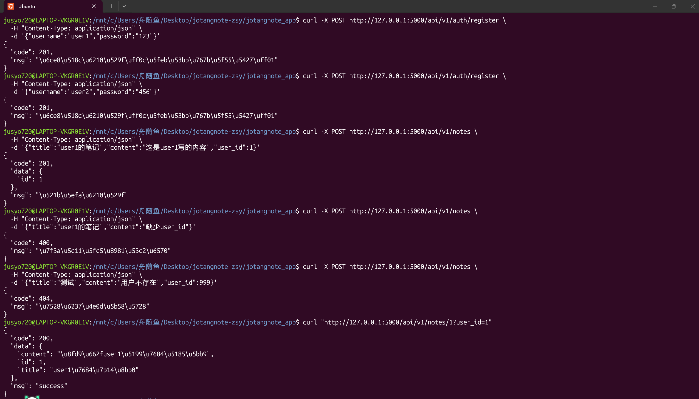
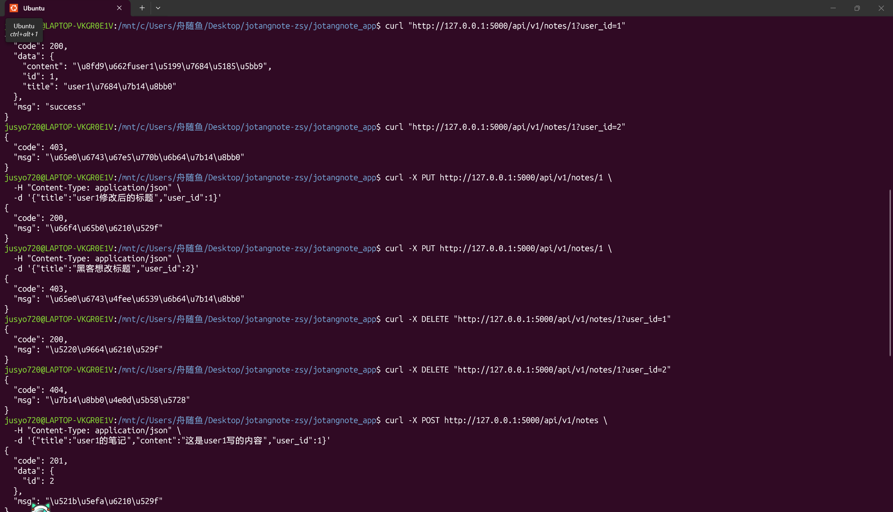
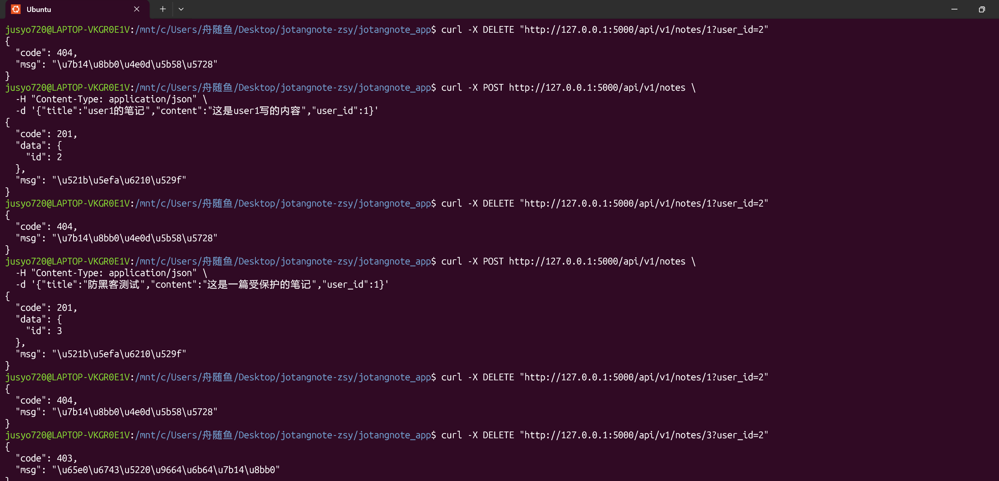
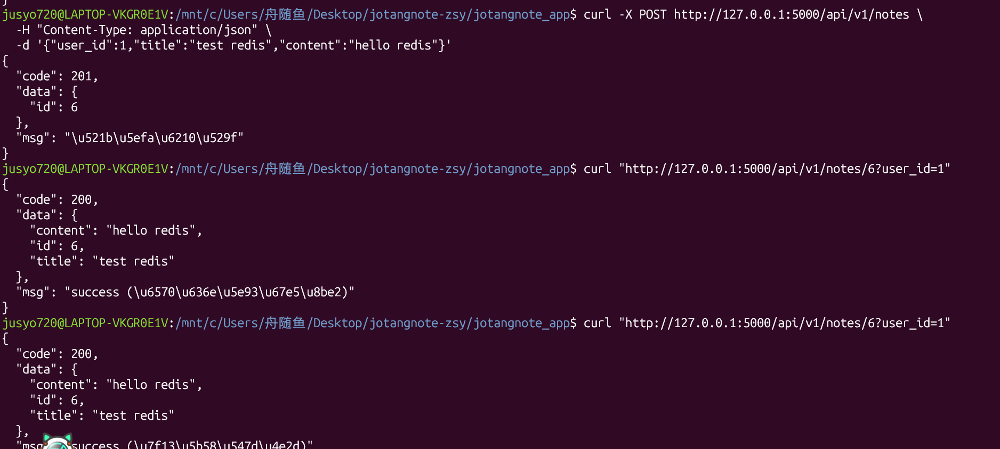
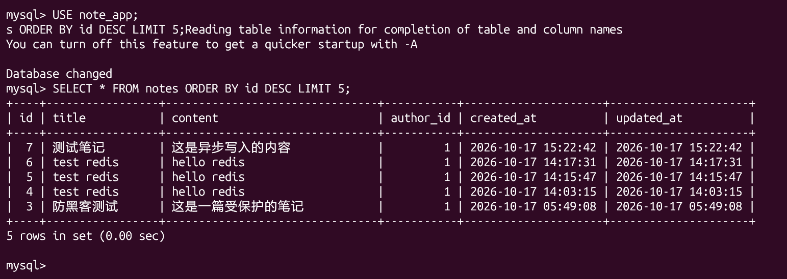
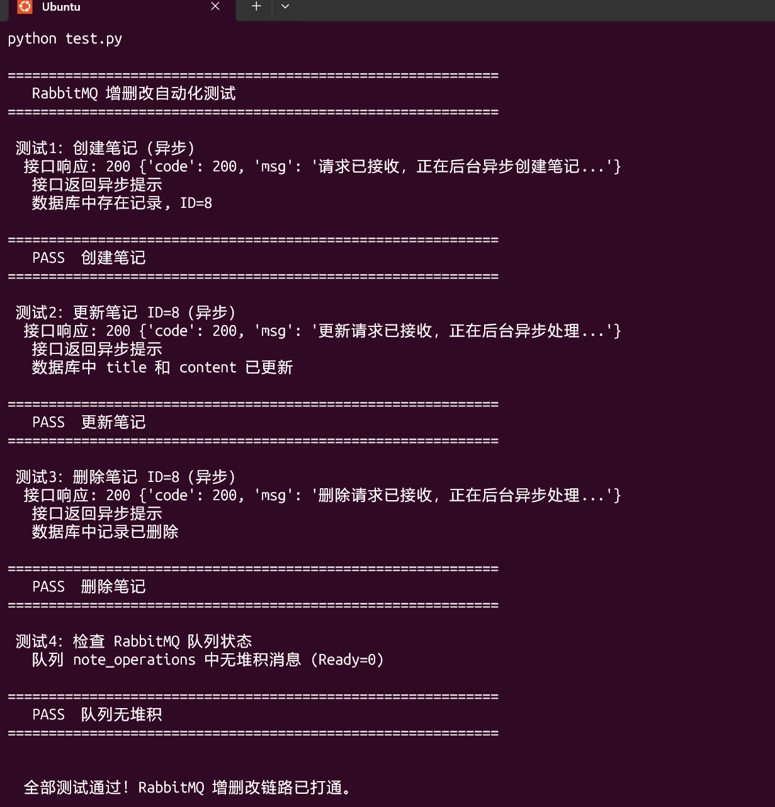
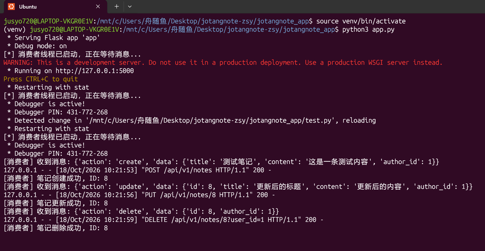